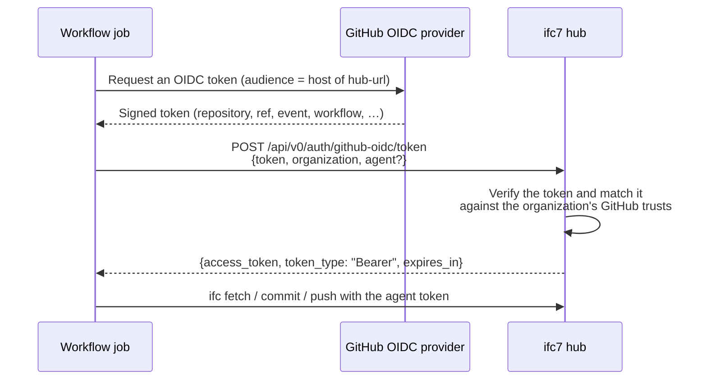

# How the action works

Each run takes four steps:

1. **Install the ifc CLI.** The action downloads the release archive for the runner from [ifc7/ifc releases](https://github.com/ifc7/ifc/releases) and checks it against the release's `checksums.txt`.
2. **Authenticate.** It exchanges the job's GitHub OIDC token for a short-lived ifc7 token, or uses the `token` input when one is given.
3. **Push.** It runs the CLI non-interactively in `working-directory`.
4. **Report.** It writes the step outputs, a job summary, and warning annotations on `ifc.yaml`.

## 1. Installing the CLI

`ifc-version` accepts a release tag (`v0.0.2` or `0.0.2`) or `latest`. The action downloads:

```
https://github.com/ifc7/ifc/releases/download/<tag>/ifc_<version>_<os>_<arch>.tar.gz
https://github.com/ifc7/ifc/releases/download/<tag>/checksums.txt
```

Here `<os>` is `linux` or `darwin` and `<arch>` is `amd64` or `arm64`. If the sha256 doesn't match, the action fails without installing the binary. `latest` follows GitHub's latest-release redirect, so it doesn't use the GitHub API or count against its rate limit.

The CLI needs to be `v0.0.2` or later. Before authenticating, the action checks that `ifc push --help` lists `--json`, so an older CLI fails with a clear message.

## 2. Authenticating

### GitHub OIDC (default)



- The job needs `permissions: id-token: write`.
- `organization` is the organization's slug. `agent` is an agent's name or ID, and is only needed when several of the organization's agents trust the workflow.
- The token returned is a short-lived agent token, valid for about 15 minutes. The action masks it and every other token in the log.
- Revisions are attributed to the agent.

### Setting up the trust

An organization admin, once per repository:

1. Creates an agent (a bot member) with the `editor` role.
2. Adds a **GitHub trust** to the agent for the repository. A trust can restrict:
   - the ref, as a glob (default `refs/heads/main`)
   - the events (default `push`, `workflow_dispatch` and `release`)
   - a GitHub environment the job must run in
   - the workflow file
   - the permission profile that caps what the token can do (default `revisions-write`)

The trust pins the repository's numeric GitHub ID on first use. A repository that is renamed, or deleted and recreated, under the same name no longer matches.

### Audience

The OIDC token's audience defaults to the host of `hub-url`: `ifc7.dev` for the default hub. Set `audience` only if your hub expects a different value. A wrong audience makes the exchange fail with HTTP 401.

### Exchange errors

When the exchange fails, the job fails with the hub's message followed by a hint:

| Status | Meaning | What to do |
| --- | --- | --- |
| 400 | The request is incomplete | Check that `organization` is set |
| 401 | The GitHub token is invalid or expired, or has the wrong audience | Check `audience` and `hub-url` |
| 403 | No trust matches this workflow. The message names the first condition that failed, such as the ref or event. | Ask an organization admin to add or fix the trust |
| 404 | The hub doesn't offer the exchange | Check `hub-url`, or pass `token` |
| 409 | Several agents trust this workflow | Set `agent` |
| 503 | The hub isn't ready to verify GitHub tokens yet | The action retries once after 5 seconds. If it still fails, re-run the job. |

### Using your own token

If `token` is set, the action skips the exchange and doesn't need `organization`. Use an agent token (`ifc_agt_…`) stored as a secret.

## 3. Pushing

The action exports `IFC_TOKEN` and `IFC_HUB_URL` (from `hub-url`) and runs:

```bash
ifc fetch --owned --non-interactive
ifc commit --non-interactive --notes "<notes>"
ifc push --non-interactive --json
```

- `fetch --owned` downloads only the interfaces in `ifc.yaml`'s `own` section that have a `ref`. It starts from an empty `.ifc/` manifest, so `.ifc/` can stay gitignored.
- `commit` adds a revision for each owned interface whose file differs from the latest revision on the hub. Unchanged files get nothing.
- `push` uploads those revisions as drafts. Releases are still published by a person in the hub.
- `notes` defaults to the HEAD commit subject followed by its short SHA, e.g. `Add billing endpoints (abc1234)`.
- Refs in `ifc.yaml` on `ifc7.dev` are resolved against `hub-url`, so one `ifc.yaml` works against any hub.

The action never commits to your repository.

## 4. Results

`ifc push --json` reports every owned interface with one of these statuses:

| Status | Meaning |
| --- | --- |
| `pushed` | A new revision was created |
| `up_to_date` | The file matches the latest revision |
| `skipped` | Not pushed. The `reason` field says why. |
| `failed` | Pushing failed. The `error` field has the message. |
| `not_attempted` | An earlier interface failed, so this one wasn't tried |

There are two skip reasons:
- `no ref in ifc.yaml`: the interface doesn't exist on the hub yet. Run `ifc push` locally once to create it, then commit the updated `ifc.yaml`.
- `no manifest entry; run 'ifc commit' first`

The action turns this report into:
- **Outputs:** `pushed` and `skipped`, as JSON arrays of interface names, and `result`, the full report.
- **A job summary:** a table of interface, ref and status.
- **Warnings:** one annotation on `ifc.yaml` for each skipped interface.

The job fails when any interface fails. Interfaces pushed before the failure still appear in the outputs and the summary.
